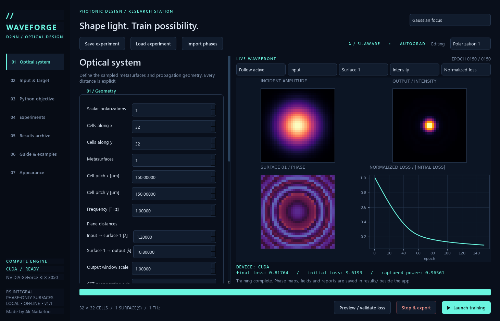

<!-- Made by Ali Nadarloo. -->
# Waveforge — Optical Neural Networks & D2NN Design Lab

[](https://github.com/AliNadarloo/waveforge-d2nn/actions/workflows/checks.yml)
[](LICENSE)
[](https://doi.org/10.1038/s41598-026-69471-w)

**Train optical neural networks (ONN), diffractive deep neural networks (D2NN),
and phase-only metasurfaces in a desktop application with live optical fields.**

Made by **Ali Nadarloo** · **School of Electrical Engineering, Iran University
of Science and Technology, Tehran, Iran**.
Developed from the computational work for the paper below and Ali Nadarloo's
master's thesis research. The application extends that research workflow with
editable Python objectives, multiple propagation methods and reusable examples.

**Get started:** [Download the Windows app](https://github.com/AliNadarloo/waveforge-d2nn/releases/latest) ·
[Install](INSTALL.md) · [Write a loss function](LOSS_GUIDE.md) ·
[Develop](DEVELOPER_GUIDE.md) · [Contribute](CONTRIBUTING.md)



- **ONN / D2NN design:** configurable cell counts, rectangular pitches, frequencies,
  layer counts and individual propagation distances, including the output plane.
- **Differentiable wave propagation:** dense Rayleigh–Sommerfeld (RS), FFT RS and
  padded angular spectrum methods (ASM), with guidance on sampling and cost.
- **Examples:** polarization-multiplexed metasurface logic gates, Gaussian focusing,
  beam steering, text/image holograms, orbital angular momentum (OAM), multiple
  output planes and a four-layer handwritten-digit detector network.
- **Python objectives:** documented complex fields, intensity, phase, coordinates,
  detector powers, OAM tools, gradients and copyable loss recipes.
- **Training:** Adam by default, four other optimizers, CUDA GPU support and CPU
  fallback, independent Polarization 1/2 channels and live normalized loss.
- **Inspect and export:** adaptive controls, four themes, selectable color maps,
  matching saved plots and explicit CST phase/coordinate tables for −z → +z.
- **Lightweight distribution:** a small Windows launcher; Python and PyTorch are
  installed separately. No CUDA libraries are bundled or downloaded by the app.

## Paper and research context

Ali Nadarloo, Mohammad Javad Hajiahmadi and Mohammad Soleimani.
**A single passive terahertz metasurface implementing eight Boolean logic gates
through polarization multiplexing.** *Scientific Reports* (2026), published
6 September 2026. [doi:10.1038/s41598-026-69471-w](https://doi.org/10.1038/s41598-026-69471-w).

The paper presets reproduce the scalar phase-design training for the eight
Boolean logic gates OR, AND, XOR, BUFFER, NOR, NAND, XNOR and NOT at 1 THz.
This application trains scalar diffractive models. Full-wave electromagnetic
validation and a fabricated unit-cell response require separate tools and data;
the app's ideal phase-design metrics are distinct from the paper's full-wave metrics.
See [verification](VERIFICATION.md), [citation files](CITATION.cff) and
[BibTeX](CITATION.bib). **If you use Waveforge, its code, examples or research method in your work,
please cite this paper.**

MIT licensed. Community improvements are welcome. Dataset and reference credits
are separate; see [third-party notices](THIRD_PARTY_NOTICES.md).

## Start

**Lightweight Windows release:** run `Waveforge.exe` in a writable folder. It
extracts readable code, guides and examples beside itself and uses an existing
Python environment. Python, PyTorch and CUDA libraries are **not bundled**.
Run `Waveforge.exe --setup` to choose Python or read installation steps.
See [INSTALL.md](INSTALL.md) for complete CPU/GPU setup and a GPU verification
command. CUDA-enabled PyTorch and a compatible NVIDIA driver enable GPU use;
CPU-only PyTorch works for CPU training. CUDA Toolkit alone is insufficient.

**Source:** with Python 3.10+ and the dependencies installed, run `python main.py`
from this folder. Tested installation versions and commands are in INSTALL.md.
CUDA-enabled PyTorch is required for GPU training.

1. Select an example from the top menu or Experiments page.
2. Set cells along x/y, surface count, x/y cell pitches and frequency.
3. Set each labeled plane distance: input → first surface → … → output, in λ.
   The last row explicitly sets the distance from the last surface to the output.
4. Choose the input aperture, illumination and target. Upload files when needed.
5. Open Python objective. Insert an example or write `loss(ctx)` using Parameters.
6. Click **Preview / validate loss** to check fields and differentiable gradients.
7. Click **Launch training**. The interface remains responsive during training.
8. Results are exported automatically under `results/` beside the source launcher
   or executable. **Stop & export** saves the current solution as an interrupted run.

**Guide & examples** inside the app works offline. How to use walks through a
first run; Guide explains geometry, inputs, solvers, optimization, Python, CST
and troubleshooting. Examples includes eleven complete experiment walkthroughs and
nine viewable/copyable loss recipes, with buttons to load a preset or insert a
recipe into the currently edited polarization.

**Loss lab** contains the extensive objective workshop also provided as
[LOSS_GUIDE.md](LOSS_GUIDE.md): tensor shapes, units, intensity/phase/OAM,
detectors, handwritten digits, regularization, multiple planes and debugging.
The Guide also displays the complete installation, user and developer manuals.

Controls adapt to the aperture, beam, target, solver and optimizer. Plane-wave
logic gates hide OAM, picture, text and digit settings. A custom Python objective
is preserved when changing selectors; built-in objectives follow the target.
Show all controls reveals additional parameters for custom objectives.

**Appearance** offers Deep space, Nebula violet, Solar amber and Daylight themes.
Input amplitude, intensity/amplitude and phase have independent color maps,
including hot, jet and winter. Live changes are immediate. Saved figures use the current theme, color maps and
field interpolation when export begins; metasurface phase cells remain unsmoothed.
After a completed run, Results archive → **Export again with current appearance**
saves a new results folder from the same trained model without retraining.
Preferences live in `ui_preferences.json`.

Changing target settings supplies new context tensors and updates a selected
built-in recipe. Custom Python code is preserved. Review the objective when
changing the task.
Experiments can be saved as JSON and reloaded. `phases.npz` can initialize a new run
through **Import phases**, after loading the matching geometry configuration.

Set **Scalar polarizations** to 1 or 2. The **Editing** selector switches between
Polarization 1 and Polarization 2. Inputs, beams, targets, detectors, losses and
initial phase maps are separate for each; geometry and optimizer settings are
shared. The independent scalar channels are optimized sequentially in one run.
Dual results have separate `Polarization_1/` and `Polarization_2/` folders.

Live controls select the active polarization, any input sample, any metasurface,
and output intensity / phase / amplitude. The loss graph defaults to
`loss(epoch) / max(abs(initial_loss), 1e-16)` and can switch to raw loss. It retains
every epoch, while the wavefronts and metrics refresh up to about 6 times/second
when computation allows. Raw loss, normalized loss, elapsed time, ETA, progress,
and custom metrics update during training. Fields shown at each refresh are
re-evaluated after the optimizer step. The recorded trace is the pre-update loss.

Training methods: **Adam** (default), **AdamW**, **SGD + momentum**, **RMSprop** and
**Adagrad**. Learning rate and weight decay apply to all; momentum applies to SGD
and RMSprop. All methods use the same differentiable optics, scalar objective and
gradient clipping. Paper presets retain Adam, lr 0.008 and zero weight decay.

## Paper reproduction

`Paper • Polarization 1` uses OR / AND / XOR / BUFFER; `Paper • Polarization 2`
uses NOR / NAND / XNOR / NOT. `Paper • two polarizations` trains both. These are
generic scalar channel names: the unit cell determines the physical polarization
basis (for example linear or circular). The presets use the authoritative `code_public/train.py`
settings: 32×32 cells, 150 µm x/y pitch, 1 THz, one surface, plane-wave input,
spacings [1.2λ, 10.8λ], radius 2.4λ and x offset ±4.68λ, detector 1 on the right,
3,000 Adam epochs, lr 0.008, zero initial phase, seed 7, gradient clipping 1.0,
desired fraction 0.975 and outside penalty 0.20. Per-class weights and per-sample
evaluation / accumulation order follow the original code. Each preset loads all
these settings; subsequent edits are allowed and become part of the saved config.

The original `exp(+iωt)` convention is retained:

`h = (1 / 2π) (1/R + i k) (z/R) exp(-i k R) (1/R) dx dy`

Dense RS uses the original transfer matrices. FFT RS is zero-padded linear
convolution of the same kernel on equal-sized grids; it is not a different
propagation approximation. The dense paper method remains the paper preset.
Coordinates are pixel centered and all grids / phase maps use `[y, x]` ordering.

## Angular spectrum and solver advice

The angular spectrum methods are **ASM • evanescent decay** and
**ASM • propagating only**. Both zero-pad the field,
apply an angular-spectrum transfer function by GPU/CPU FFT, and crop the requested
observation window. The default is four samples per cell and 3× zero padding,
to resolve subcell field structure. Cell phases remain one parameter per cell;
constant-cell fields are expanded to the fine grid, and fine fields remain fine
between surfaces. They are not averaged back to cell centers between layers.

All app methods use the same `exp(+iωt)` convention. ASM uses `exp(-i*kz*z)`;
the evanescent variant additionally uses `exp(-alpha*abs(z))`. The
propagating-only variant removes spatial frequencies outside the propagating
disk. Both methods use the app's common phasor convention.

The solver recommendation considers the original paper geometry, array dimensions,
surface count, cell pitch / wavelength, propagation distances, target structure,
output-window scale and estimated transfer-function memory. **Apply recommended
propagation** selects the suggested method. Recommendations are explicit heuristics;
they never silently change your experiment and do not prove numerical convergence.
Compare increased ASM sampling, padding and field of view for short-distance,
high-angle or long-distance tasks. Transfer-function memory estimates exclude
autograd, field stacks and FFT workspace. The ASM example demonstrates subcell OAM
conversion; the paper presets retain Dense RS.

With ASM, `ctx['dx']` / `ctx['dy']` and `pixel_area` describe the fine FIELD samples;
`cell_dx` / `cell_dy` describe physical cells. Field and layer arrays use the fine
grid; `surface_phases` stays at the cell resolution. Numeric aperture files are
still cell-grid arrays, expanded as piecewise-constant cells. Power ratios use the
same fine input/output sampling, avoiding a spurious samples-per-cell squared factor.

## CST phase export

The confirmed default is illumination from **−z toward +z**, with surfaces in the
**xy plane**. `CST_phase_layer_N.txt` contains explicit
`x_um y_um z_um phase_rad phase_deg amplitude` at physical cell centers. The layer
positions include the configured input-to-surface spacings. Columns run from
negative to positive local x, rows from negative to positive local y. There is no
automatic mirror, transpose or phase conjugation. Signed phases are included in
the CST tables; the paper-compatible `best_meta_layer_N.txt` retains [0,2π) radians.

An export pop-up explains the axes, ordering, units, transmission phase
`t=exp(+iφ)`, and the reference-plane convention. The same explanation is saved as
`CST_EXPORT_README.txt`. Match your CST unit-cell library's transmission phase and
reference plane when converting desired phases into physical geometry. Alternative
CST export axes apply an explicit right-handed rotation recorded in the explanation;
the scalar training coordinate system remains unchanged.

The original aperture encoding is reproduced exactly at 32×32, with proportional
row/column blocks for other sizes. Complementary gates require separate channels
because they share an input aperture. The app trains channels separately and does
not simulate anisotropic cell geometry, polarization conversion or CST full-wave
behavior. Numerical precision, hardware and PyTorch versions can change a long
optimization trajectory. See the verification report for measured agreement,
rather than assuming bit-identical phase maps on every device. The historical
`_organized/code/Train.py` has intermediate settings; it is not the paper preset.

## Inputs and illumination

Apertures: open, circle, double slit, paper logic gates, text/number, picture or
numeric array. Beams: plane wave, Gaussian, LG p=0 OAM, Bessel–Gauss; all allow
x/y tilt. Beam waist is the field amplitude 1/e radius; OAM has integer charge.
The Bessel–Gauss transverse radial scale is `J0(4r/waist)`.

Raster formats supported by Pillow include PNG, JPEG, TIFF, BMP, GIF (first frame)
and WebP. Pictures are converted to grayscale, multiplied by alpha, and resized
to the current grid. White transmits, black blocks. Raster rows are flipped so
the picture appears upright on Cartesian plots. Text is centered with its aspect
ratio preserved. Numeric NPY/CSV/TXT files retain array row order and must match
the grid exactly. NPY and CSV/TXT may contain complex fields for input amplitude
and phase. NPY is loaded without pickle. Real input arrays must be nonnegative.
Target images / numeric arrays represent nonnegative intensity, not amplitude.
For phase shaping, choose an OAM target or define a complex target in Python.

## Custom Python

`loss(ctx)` returns one finite real differentiable PyTorch scalar. Available
globals are `torch`, `math` and normal Python builtins. User code executes locally
with normal Python privileges; use code you trust. Build the loss using tensor
operations. `.item()`, `.detach()` and NumPy break the optimization gradient.

Optional `metrics(ctx)` returns a dictionary of scalar values. `plots(ctx)` returns
named real 1D/2D arrays; intensity, phase, error maps, ROI masks or OAM spectra can
be plotted. Metrics update live and are saved on the final fields. Custom plots
run on final fields without gradient tracking.
Raw custom plot arrays are saved alongside PNGs. A plot error is recorded in the
summary and does not discard the trained phases. Field stacks are exported for
every input sample; the live selectors switch samples, surfaces and polarizations.

The Parameters tab is the complete tensor/function reference. Nine examples cover
intensity shaping, original logic loss, complex mode overlap, wrapped phase,
detector efficiency, two-plane training, smooth phase, centroid steering and
ten-circle digit classification.
`at_z(z_m)` measures distance from just after the last surface and caches the
corresponding propagation operator. Choose a fixed, finite set of extra planes.

The OAM diagnostic samples 64 azimuth angles and 24 radial rings in an inscribed
circle, computes angular Fourier power and integrates with radial weighting.
Displayed orders −8…8 are normalized to total sampled angular power, so the
truncated spectrum need not sum to one. Angular purity is distinct from complex
mode overlap, which also tests the radial profile. Off-axis diagnostics are
centered at the configured target x/y coordinates.

## Results

Each run has a unique timestamped folder containing:

- `best_meta_layer_N.txt`: paper-compatible `i j phase(rad) amp` columns, phase
  modulo 2π and fixed amplitude 1. These are the final iterates, matching the
  original trainer's convention; the filename does not imply best-epoch selection.
- `phase_layer_N_radians.csv`, `phase_layer_N_degrees.csv`, `phase_layer_N.png`.
- `phases.npz`: original optimization phase and wrapped phase stacks.
- `fields.npz`: complex input/output fields, layer fields, targets and coordinates.
- `training_loss.csv`, loss curve; input amplitude, output intensity and phase PNGs
  for each sample; target PNG; custom plot PNGs / arrays.
- `truth_table.csv` for logic tasks; `summary.json` for metrics, timing and device.
- `config.json`, `loss.py`, and a short description of units and conventions.

Intensity uses relative field units. Integrated energy adds the cell area.
Detector fractions use energy in the sampled output plane as their denominator,
exactly as in the paper; they are not absolute input-to-output efficiency.
Increasing output-window scale can expose energy outside the original window.
Scalar quadrature is a design tool; it needs sampling / aperture convergence checks
and does not replace electromagnetic fabrication validation.

## Command line, tests and build

```text
python main.py --headless --preset "Gaussian focus" --epochs 100
python main.py --headless --config my_experiment.json --cpu --output results
python -m pytest tests -q
python build.py
```

Source map: `config.py` settings; `physics.py` grids / propagation / surface model;
`inputs.py` apertures / beams / targets; `objectives.py` context / examples;
`training.py` optimization; `export.py` artifacts; `presets.py` examples;
`ui.py` desktop interface; `guide.py` offline help; `main.py` entry point. Modules
are in `onnlab/`. The public source includes the application, portable experiment
JSONs, data attribution, guides, tests and build workflow. Optional `reference/`
fixtures are used for local comparisons against the original trainer; public
checkout tests skip those comparisons when the fixtures are absent. The app and
its paper presets run independently of those fixtures. Pandas is only needed for
the optional reference aperture helper, not the application runtime.

See `DEVELOPER_GUIDE.md` to modify the app. Separate copyable loss functions are in
`examples/loss_functions/`; eight configurations validated at different frequencies
are in `examples/validated_uses/`. `requirements-lock.txt` records the tested versions.
`bootstrap.py` displays a responsive launch window while the numerical libraries
load. General multi-input propagation is batched, and live previews are reduced
before GPU-to-CPU transfer. Training and exports keep their full resolution.

## Four-layer handwritten digit recognition

Advanced • four-layer digit router uses four phase surfaces to classify handwritten
0–9 into ten labeled circular output detectors. The default uses FFT RS, 32×32
cells, 1 THz, plane illumination, spacings [1,3,3,3,8] λ, 100 epochs, Adam at 0.02,
batch size 64 and small random initial phases. The final labeled distance is the
last surface → output distance; change it before training to design another plane.
Ring radius (default 5λ) and each detector radius (0.9λ) are configurable.

The bundled UCI/scikit-learn handwritten images are split deterministically into
1,438 training and 359 held-out samples. Held-out samples never update the phases.
Mini-batch training keeps memory bounded. Recognition uses the strongest integrated
circle power. Saved predictions, confusion matrix and accuracy curves cover the
complete selected splits; live/exported fields show one held-out example per digit.
Dataset attribution and preprocessing are in `examples/digits/DATASET.md`.
This is a separate educational split, not MNIST or the original UCI benchmark split.

Official runtime references:
[CUDA availability](https://docs.pytorch.org/docs/stable/generated/torch.cuda.is_available.html),
[PyTorch FFT](https://docs.pytorch.org/docs/stable/generated/torch.fft.fft2.html),
[PyTorch installation](https://pytorch.org/get-started/locally/).
